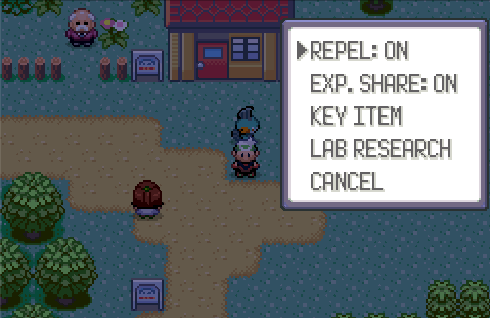
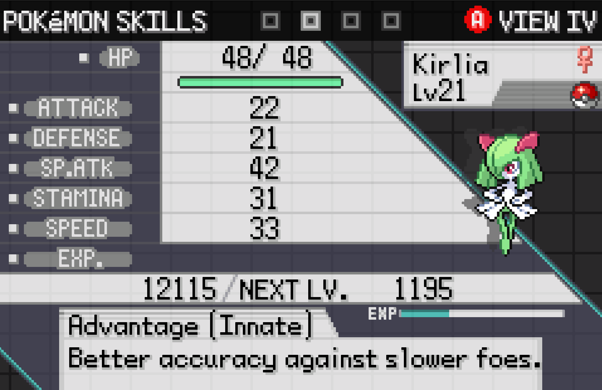
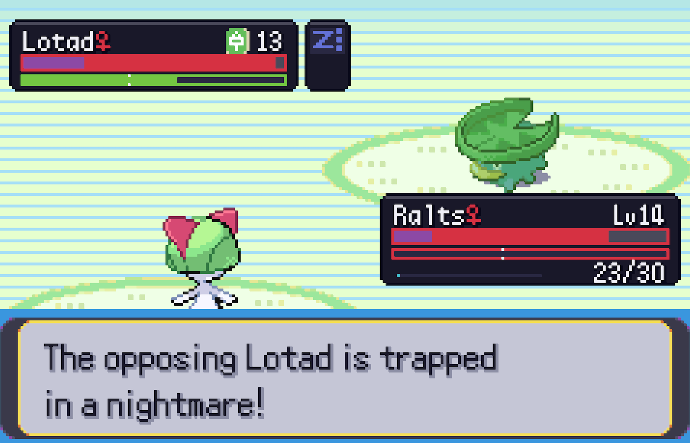

# README

## TL;DR

This is an emerald hack (based on RHH's 1.17) that alters battle rules significantly. Pokemon gains 2 innate commands, can have up to 6 moves; rebalance natures with a bonus ability, new/ reworked status effects that can all stack with each other!  

## Intro

I'm sure everyone of us who grows up watching the anime always once wondered why we can't just shout "Pikachu, Dodge!" and whatever comes our way will miss. The initial idea of this hack comes from that. I'm also trying to "fix" some of my gripes with the standard battle rules (these come from the 6v6 singles pov, have nothing to do with the single player games), namely the persistent speed tier, boring nature choices, the over reliance on switching/ typing match up, and hax. As a result, the game I'm designing will be "difficult", as in you'll need to take into account all the old and new mechanics to beat it. I try not to design for brute force gameplay, so a lot of QoLs are also implemented. Keep in mind, the game is in **Alpha** stage. It is playable, but not finished, and not close to being finished.

*What this is not*: >! a story/ region remake, nor a capture-first exploration hack. The game should be treated as a new puzzle collections, set in Hoenn.!<

## The changes

* The biggest that drives the rest of the design, is that **SpDef is replaced by Stamina**. Mitigation will only use the Def stat, but each move will now cost Stamina to use.
* Turn speed is **calculated live** each turn, based on Stamina of the battlers. Fast pokemons that don't invest in Stamina will run out of gas really quick, and there will be consequences.
* Pokemon will gain 2 innate commands, Dodge and Recuperate. You can decide to use these innate moves instead of a regular move, as the situation calls for. Dodge check runs separately from accuracy, and has many smaller rules you'll have to play to find out. Recuperate will restore Stamina, among other things, so use this lest you wanna risk automatic **crits**.
* That's right. Exhausted mons (0 live stamina) are automatically subjected to critical hits. Crits also deal the bonus damage as **Trauma** (unhealable hp damage).
* What the hell is Trauma??? Well, what I also hate about vanilla rules is mons die too damn quick, but if they stall they die too damn slow. So I halve the effective damage in the calculation, making players think more about what to do instead of clicking the SE move. **Special damage will also inflict Trauma** so tanks don't live forever, but in the meantime you'll have to deal with what's in front of you.
* What about Physical damage? It doesn't deal Trauma, but exerts stamina pressure. Taking physical damage will drain stamina. Physical crits deal both.
* Hax shouldn't frustrate you anymore, because now they procs **twice** as often. Status in general now have stages, 1 -> 3. Secondary effects only inflict **Lv1 Statuses**, stackable with itself and each other. An unfortunate proc doesn't ruin your day, but ignore it and you'll have a bad time since statuses have synergies and anti-synergies.
* Do you get irritated that your starter isn't Adamant/ Modest/ Jolly/ Timid? I do; so I give each nature an innate ability. They're designed to cope with and or abuse the new mechanics.
* Your pokemons can get a Signature Move. This does not take up a move slot. But beware, your rivals do too.

These are only the big changes. Many smaller/ QOL ones are >!4x resistance/ effectiveness clamped to 2x; held TMs allow using the move; accelerated overworld speed; easy EVs; easy HM; free repel; global EXP; easy leveling; non-Hoenn pokemons; TM in marts; Mega/ Z Moves/ Tera etc etc !<

## The progress

**help wanted**.

I'd like to think all the engine mechanics are done, but more playtest is needed. All the big battles have to be redesigned, but only **up to the 3rd gym** are. If you play please treat post-Wattson as **untested bullshit**.

Questlines that give out gimmick held items are tbd. Such items can appear in shops but require farming/ grinding, which is not what I want.

I'd love to get help from artists to redesign the UI (and arts), since they're AI generated at the moment. usable as placeholders, but clobbered together. AI in general is used with me in the loop; I'm a dev by trade. The @`design.md` doc is for both humans and agents.

Contributions/ requests should first communicate through Github Issue, including gameplay/ balance complaints. 

### Milestone

* Story progression: playtest and rebalance gym 4-8, including guest leader battles, then E4
* Gimmick held item acquisition: plan quests, drops, and/ or mechanics to tie with player progression
* Villain battles: haven't started. they should be hard too
* Economy balance: egg prices, research rewards, mega vs z move vs tera
* Non-hoenn pokemon acquisition: need more pathways/ quests to acquire

## Closing

I make this thing for myself first and foremost, so forgive any annoyance you see/ encounter. If you decide to try it out, don't treat it as a pokemon game. Many rules you think you know will not be true.  
